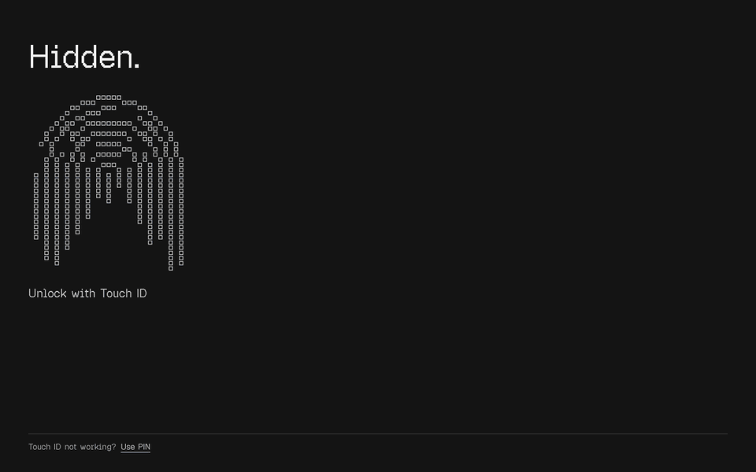
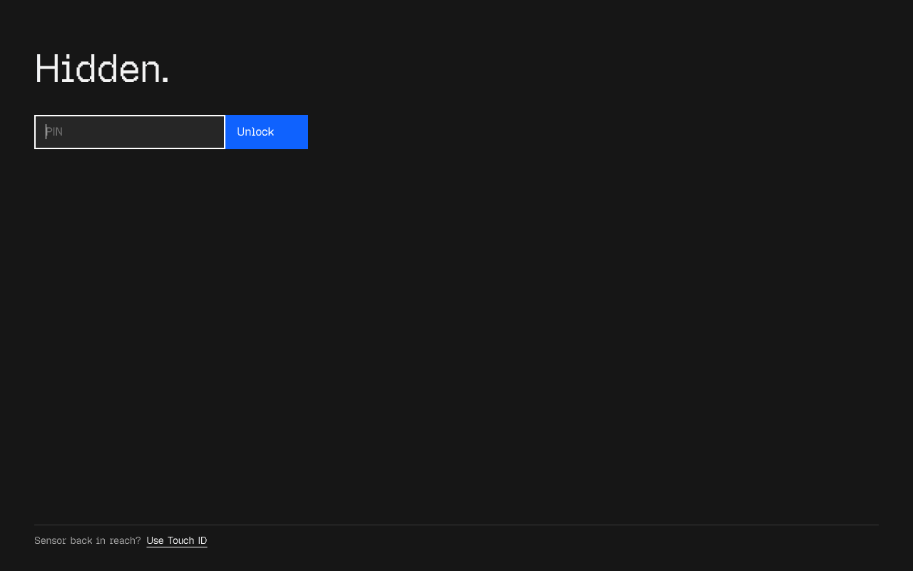
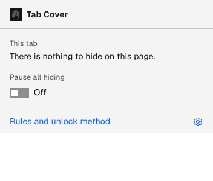
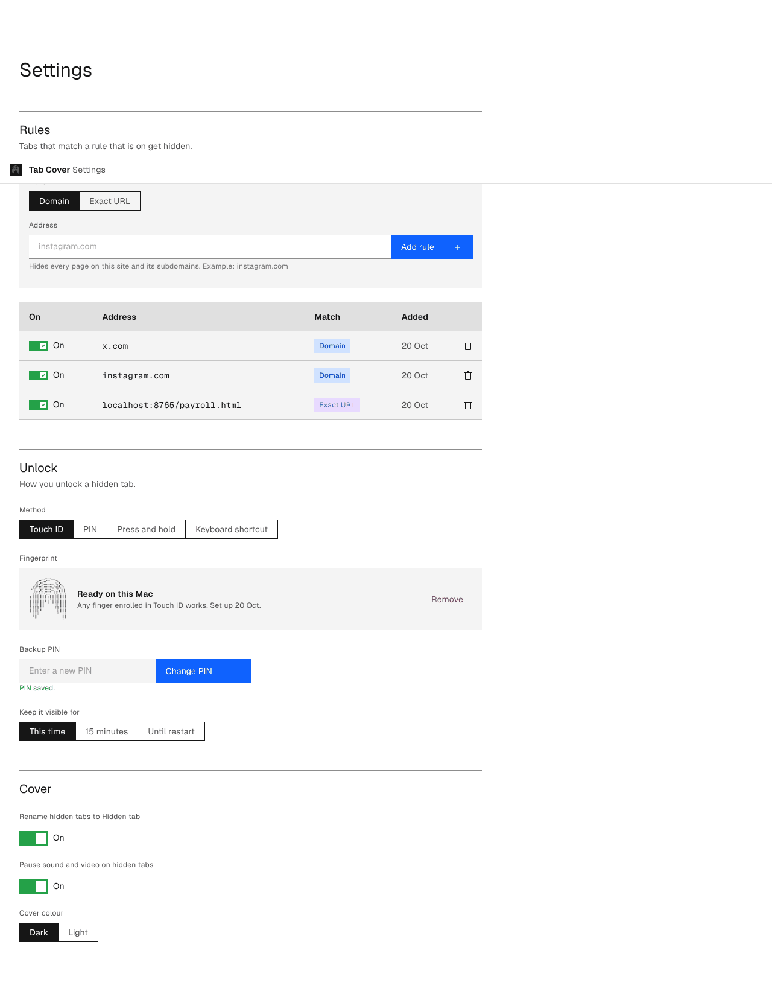

# Tab Cover

Hide any tab you choose behind a cover. Unlock it with Touch ID.

Open a tab whose address is on your list and a full screen cover sits on top of it, in that tab only. The page keeps running underneath, so unlocking is instant. Useful when you share your screen, present, stream, or just do not want a salary sheet on display at your desk.

## What it does

- **Hides tabs by rule.** A rule is a domain (every page on the site and its subdomains) or one exact URL.
- **Unlocks with Touch ID.** A backup PIN sits on the bottom edge for when the sensor is out of reach. Press and hold or a keyboard shortcut also work.
- **Renames the tab.** While covered, the tab strip shows "Hidden tab", so the real title never leaks during a screen share.
- **Pauses sound and video** on the hidden page.
- **Stays visible as long as you choose:** this time only, 15 minutes, or until the browser restarts.
- **One click from the toolbar:** hide the current site, hide now, or pause all hiding.

| Cover | Backup PIN | Toolbar |
| --- | --- | --- |
|  |  |  |

## Install

Tab Cover is not on the Chrome Web Store yet. Install it from this repo in about a minute. It works in Chrome, Arc, Brave and Edge.

1. Click **Code**, then **Download ZIP**, and unzip it into a folder you will keep.
2. Open `chrome://extensions` and switch on **Developer mode**.
3. Click **Load unpacked** and choose the unzipped folder.
4. The settings page opens. Set up Touch ID, save a backup PIN and add your first rule.

Tabs that were already open start hiding after you reload them.

## How it is built

- **Manifest V3**, plain JavaScript, no build step and no dependencies.
- **Touch ID through passkeys.** The extension registers a passkey on your Mac (WebAuthn, user verification required). Unlocking opens a small extension window that asks macOS for Touch ID. No server, no account.
- **The cover lives in a closed shadow root**, so a page's own styles and scripts cannot reach it.
- **The PIN is stored as a salted SHA-256 hash.** Five wrong tries lock it for 30 seconds.
- **Designed in Seeghra**, a personal design system built on IBM Carbon tokens with Vercel's Geist type. The cover and the pixel fingerprint are set in Geist Pixel Square.

## Good to know

- Any finger enrolled in Touch ID can unlock, and macOS also accepts the Mac password in its prompt.
- Tab Cover is a privacy screen, not a lock. Anyone who can open `chrome://extensions` can switch it off.
- Nothing leaves your computer. Rules and settings sync through your Chrome profile; the passkey and PIN stay on this Mac.

## Roadmap

- Hide personal details inside pages while you share your screen: email addresses, phone numbers, names.

## Credits

- Design tokens and icons: [IBM Carbon Design System](https://carbondesignsystem.com) (Apache 2.0).
- Type: [Geist, Geist Mono and Geist Pixel](https://vercel.com/font) by Vercel (SIL Open Font License 1.1).

## Licence

MIT, see [LICENSE](LICENSE). Made by [Gokulraj Prabhakaran](https://github.com/itsgrj).
